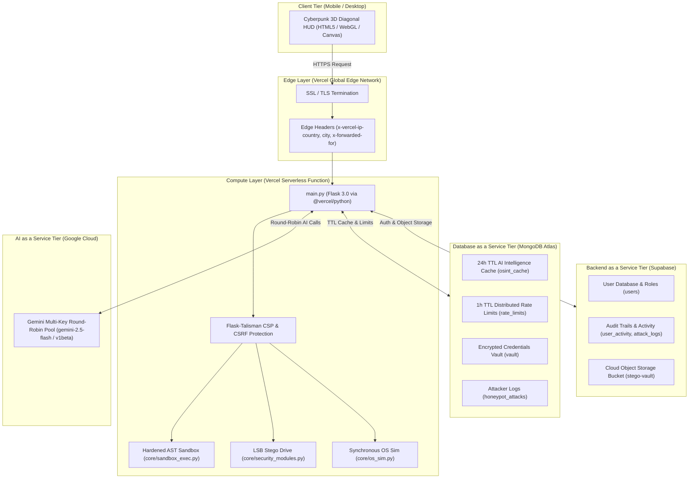
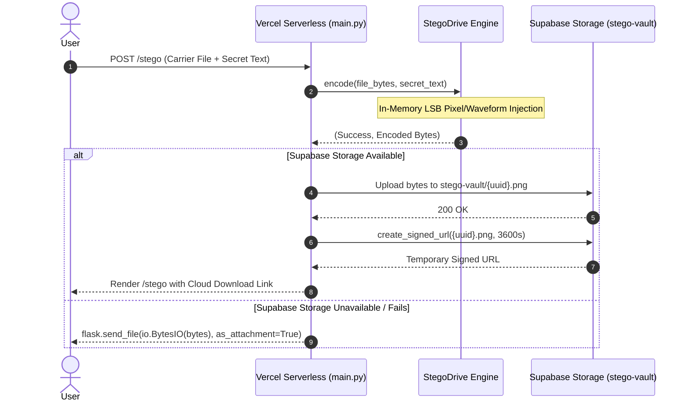
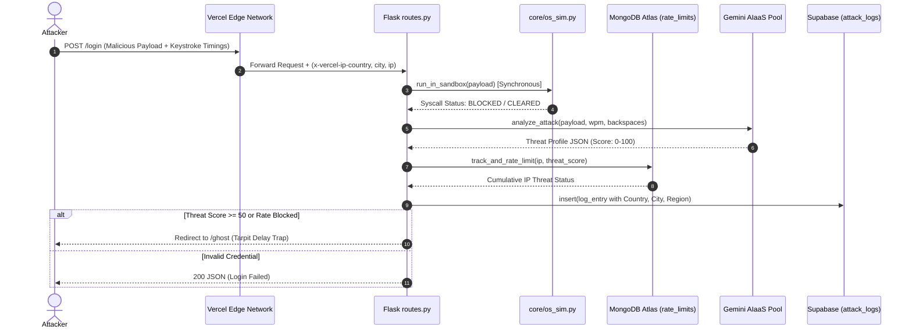

# Cloud Computing & Systems Architecture Specification

This document outlines the **Cloud Computing Architecture** of **NeuroNet-Mobile**, detailing its distributed topology, serverless execution model, data flows, and security model.

---

## 1. Architectural Philosophy

NeuroNet-Mobile is designed around the **Stateless Micro-Compute & Managed Cloud Services** pattern:
- **Zero Local Disk Dependency:** The application makes zero assumptions about persistent local storage. Ephemeral `/tmp` operations are strictly cleaned up within request boundaries.
- **Strictly Managed Stack:** Uses exclusively **Vercel**, **MongoDB Atlas**, **Supabase**, and **Google Gemini** with zero unnecessary microservices or external sandbox runtimes.
- **Resilience through Degradation:** Every external cloud dependency (MongoDB, Supabase, Gemini) features an automated, graceful fallback mechanism to ensure the application stays online 100% of the time.

---

## 2. Distributed Cloud Architecture Diagram

---

## 3. Four Pillars of the Architecture

### Pillar 1: Serverless Micro-Compute (Vercel)
- **Engine:** `@vercel/python` packaging `main.py` entrypoint.
- **Stateless Execution:** Container instances spin up, process single requests, and scale to zero during inactivity.
- **Lifecycle Guarantees:** Ephemeral memory isolation; no cross-request state leakage through local disk.
- **Edge Metadata:** Enriched request headers provide geo-location (`x-vercel-ip-country`, `x-vercel-ip-city`) without requiring external MaxMind GeoIP databases.

### Pillar 2: AI as a Service — AIaaS (Google Gemini)
- **Model:** `gemini-2.5-flash` utilizing `v1beta` API endpoint with JSON MIME type enforcement.
- **High-Availability Key Pooling:** Multi-key round-robin pool distributing load across up to 5 distinct Gemini API keys.
- **Dynamic Failover:** Automatic failover upon HTTP 429 (rate limit) or quota exhaustion.

### Pillar 3: Distributed Caching & DBaaS (MongoDB Atlas)
- **Engine:** MongoDB Atlas with native Time-To-Live (TTL) B-tree indexes.
- **24-Hour OSINT Intelligence Cache (`osint_cache`):** Caches expensive LLM OSINT scans keyed by normalized query strings. Automatically expunged after 86,400 seconds.
- **1-Hour Distributed Rate Limiter (`rate_limits`):** Synchronizes threat scores and request volume across independent serverless function instances.

### Pillar 4: Backend as a Service — BaaS & Object Storage (Supabase)
- **Relational Storage:** PostgreSQL instance managing authenticated users, administrative approvals, and attack histories.
- **Cloud Object Storage (`stego-vault`):** S3-compatible cloud object storage hosting encoded steganographic images and audio waveforms.
- **Presigned URLs:** Generates 1-hour signed access URLs, offloading bandwidth and egress from Vercel serverless containers.

---

## 4. End-to-End Request Lifecycles

### A. Steganography Injection & Cloud Storage Workflow

### B. Distributed Honeypot & Edge Geolocation Workflow

---

## 5. Security Architecture

1. **Content Security Policy (CSP):** Managed via `Flask-Talisman`:
   - `default-src: 'self'`
   - `script-src: 'self' 'unsafe-inline' https://cdn.jsdelivr.net https://cdnjs.cloudflare.com`
   - `connect-src: 'self' https:` (ensures live `/api/cloud-health` AJAX and cloud assets operate without interruption)
   - `img-src: 'self' data: https:` (supports inline steganography previews and Supabase presigned URLs)
2. **CSRF Protection:** Managed globally via `Flask-WTF` (`CSRFProtect`).
3. **AST Sandbox Isolation:** Sandboxed code cannot execute system calls, inspect environment variables, or import unauthorized modules.
4. **Least-Privilege Secret Management:** Secrets are injected strictly via Vercel Environment Variables and never committed to version control.
